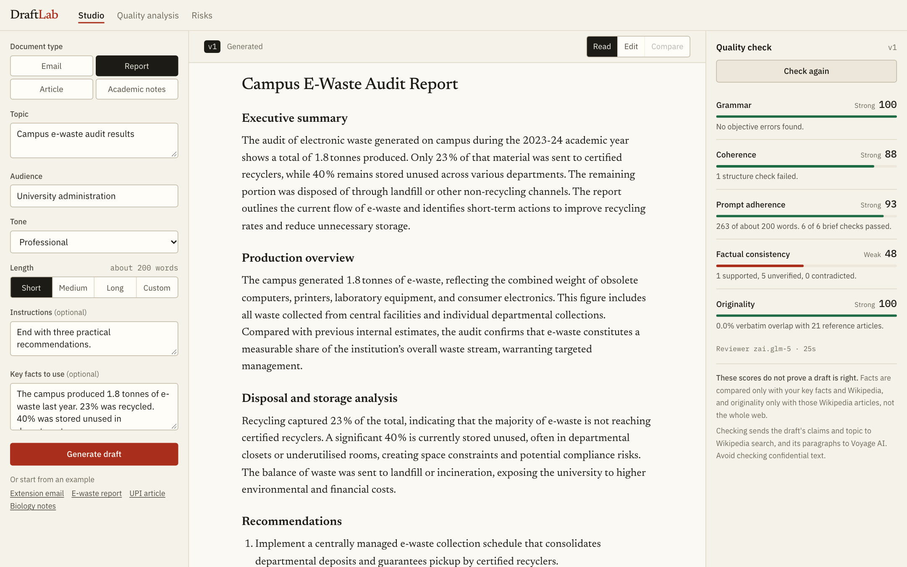
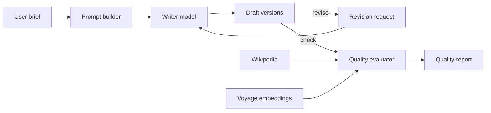

# DraftLab

A GPT-powered writing assistant that also checks its own work. DraftLab turns a short brief into an email, report, article, or academic notes, lets you revise the draft, and scores each version on five separate quality measures.

   



## Features

- **Structured briefs:** set the document type, topic, audience, tone, and length, with optional instructions and key facts.
- **Streaming generation:** the draft appears as it is written, and you can stop it at any point.
- **Revision:** change the whole draft, rewrite one selected passage, or edit by hand. Every change is saved as a version.
- **Version compare:** see any two versions side by side, word by word.
- **Quality check:** five scores with specific findings. Each signal is labelled as measured by code, a reviewer's opinion, or evidence-backed.
- **Quality analysis and risk pages:** sample content, scores, and measured risks of inaccurate or biased output, all from a saved evaluation run.

## How it works



| Role | Implementation |
| --- | --- |
| Writer | `openai.gpt-oss-120b`, through the OpenAI SDK and the Bedrock Mantle endpoint |
| Reviewer | `zai.glm-5`, a different model, so the writer does not grade itself |
| Evidence | Wikipedia lead sections ranked with BM25, plus the full main article for copy detection |
| Embeddings | Voyage `voyage-4`, for paragraph flow and close-paraphrase checks |

### The five measures

| Measure | How it is scored |
| --- | --- |
| Grammar | 100 minus 20 points per verified error per 100 words |
| Coherence | 75% six structure checks, 25% neighbouring-paragraph similarity |
| Prompt adherence | 20% length, 20% format rules, 60% reviewer checks |
| Factual consistency | Supported claims earn full credit, unverified half. Penalties for contradictions, internal conflicts, and unsourced figures |
| Originality | Penalties for verbatim 6-word matches, close-paraphrase flags, and stock phrases |

There is no overall score on purpose, because averaging would let strong grammar hide a factual problem. A failed check shows "Not scored", never a default number. The weights and thresholds are reasoned choices, not fitted to data.

## Getting started

You need [Node.js](https://nodejs.org) 20.9 or newer, plus API keys for the model endpoint and Voyage AI.

### macOS and Linux

```bash
git clone https://github.com/SurajsinghBayas/draftlab.git
cd draftlab
cp .env.example .env.local   # then add your keys
npm install
npm run dev                  # http://localhost:3000
```

### Windows

**PowerShell**

```powershell
git clone https://github.com/SurajsinghBayas/draftlab.git
cd draftlab
Copy-Item .env.example .env.local   # then add your keys: notepad .env.local
npm install
npm run dev                         # http://localhost:3000
```

If PowerShell says running scripts is disabled, use `npm.cmd` in place of `npm`, or use Command Prompt.

**Command Prompt**

```bat
git clone https://github.com/SurajsinghBayas/draftlab.git
cd draftlab
copy .env.example .env.local
notepad .env.local
npm install
npm run dev
```

If you have `draftlab.zip` instead of the repository, replace the first line. In PowerShell, use `Expand-Archive draftlab.zip -DestinationPath .`. In Command Prompt on Windows 10 or newer, use `tar -xf draftlab.zip`.

### Environment variables

Set these in `.env.local`. The file is ignored by git.

| Variable | Required | Purpose |
| --- | --- | --- |
| `OPENAI_API_KEY` | Yes | Key for the model endpoint |
| `OPENAI_BASE_URL` | Yes | OpenAI-compatible endpoint URL |
| `VOYAGE_API_KEY` | Yes | Key for Voyage AI embeddings |
| `WRITER_MODEL` | No | Overrides the writer model |
| `JUDGE_MODEL` | No | Overrides the reviewer model |
| `VOYAGE_MIN_INTERVAL_MS` | No | Pacing between embedding calls. Set to `0` once your Voyage account has billing |

`/evaluation` and `/risks` read saved results and load without keys. Generating and checking drafts need them.

### Commands

These are the same on every platform.

| Command | What it does |
| --- | --- |
| `npm run dev` | Starts the development server |
| `npm run build`, then `npm start` | Builds and runs the production version |
| `npm test` | Runs the unit tests for the deterministic measures |
| `npm run typecheck` | Checks types. Run `npm run dev` or `npm run build` once first, because Next.js generates some of them |
| `npm run eval` | Reruns the full evaluation, about 20 minutes on a rate-limited Voyage key |
| `npm run report` | Rebuilds `docs/report.pdf` |

## Pages

| Page | What it shows |
| --- | --- |
| `/` Studio | Brief form, streaming draft, revision, version compare, and quality check |
| `/evaluation` | Sample content and the quality analysis of 12 representative prompts |
| `/risks` | Measured risks of inaccurate and biased output, with mitigations |

## Evaluation results

Twelve representative prompts, three per document type, were written by the writer model and reviewed by the reviewer model.

| Measure | Mean score (of 100) | What it means |
| --- | --- | --- |
| Grammar | 100 | The check also counted 16 of 16 errors injected on purpose |
| Coherence | 98 | Damaged structure lowered it every time |
| Prompt adherence | 96 | Good, though long formats run over the word target |
| Factual consistency | 62 | Low mostly because claims could not be confirmed, not because they were wrong |
| Originality | 92 | No real copying found, checked against Wikipedia only |

- **Claims:** of 57 claims checked, 20 were supported, 37 stayed unverified, and 0 were contradicted.
- **Evaluator validity:** scores responded as expected in 21 of 21 deliberate damage tests.
- **Revision:** the reviewer judged 7 of 8 revision requests as carried out, and 10 of 10 required figures were kept.
- **Invented details:** with guardrails, 4 of 9 drafts contained unsupplied specifics, about 3 per draft. Without them, 9 of 9 did, about 14 per draft.
- **Neutral pronouns:** guardrails raised "they" from 3 to 9 of 20 drafts for workers of unstated gender.

The analysis has limits. No person labelled the drafts, and twelve prompts show patterns rather than firm rates. Guardrails reduced invented details and did not remove them, so check names, figures, and citations before relying on a draft.

To rerun selected sections, name them. Results go to `data/eval-results.json`, and the pages read from that file, so re-read the written commentary after a new run.

```bash
npm run eval -- traps bias   # sections: standard traps bias revision calibration retest
```

## Project structure

```text
src/app/            Pages and the generate, revise, and evaluate API routes
src/components/     Studio, brief form, draft pane, quality panel, and sample explorer
src/lib/            Prompts, model client, retrieval, text utilities, and bias checks
src/lib/evaluate/   One module for each of the five measures
eval/               Test prompts, evaluation runner, and report generator
data/               Saved evaluation results
docs/               Case study report, blank template, and screenshots
```

## Case study report

`docs/report.pdf` is the completed report, and `docs/report-template.pdf` is the blank college template. Group Number, Subject, and Submitted To stay blank until you supply them:

```bash
npx playwright install chromium   # first time only
npm run report -- --group 7 --subject "Your subject" --to "Prof. Name"
```

## Known limits

- **Voyage's free tier allows 3 requests a minute** without a payment method, so embedding calls are paced 21 seconds apart.
- **Wikipedia rate-limits anonymous API use.** After a 40-second evidence deadline, remaining claims stay unverified.
- **The factual score is noisy.** It moved up to 33 points on an unchanged draft, because the reviewer's claim selection varies.
- **Originality is not a web plagiarism check.** It compares only against the fetched Wikipedia articles.
- **Privacy:** generating sends the brief to the model provider. Checking also sends claims and topic to Wikipedia search, and paragraphs to Voyage AI. Do not use confidential content.
- **Prototype scope:** the rate limiter is per process and in memory, there are no accounts, and drafts are stored only in the browser's local storage.

## Author

Built by [SurajsinghBayas](https://github.com/SurajsinghBayas).
